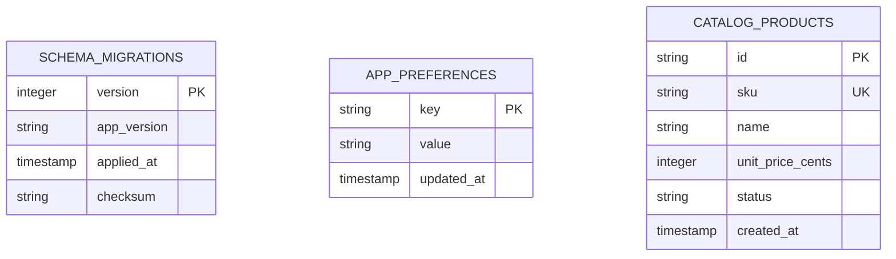

# Blueprint: Persistencia Local, Rutas del SO y Migraciones On-Startup

## 1. Diagrama Entidad-Relacion (Mermaid)

---

## 2. Rutas Estandar por Sistema Operativo (`os_data_paths`)

| Directorio | Windows | macOS | Linux (XDG) |
| :--- | :--- | :--- | :--- |
| **Datos (`data_dir_policy`)** | `%APPDATA%\AppName\data` | `~/Library/Application Support/AppName/data` | `$XDG_DATA_HOME/AppName` |
| **Cache (`cache_dir_policy`)** | `%LOCALAPPDATA%\AppName\cache` | `~/Library/Caches/AppName` | `$XDG_CACHE_HOME/AppName` |
| **Logs (`logs_dir_policy`)** | `%LOCALAPPDATA%\AppName\logs` | `~/Library/Logs/AppName` | `$XDG_STATE_HOME/AppName/logs` |

---

## 3. Diccionario de Datos Embebido

### Tabla: `catalog_products`
- **Modulo Propietario:** `catalog` (`MOD-CATALOG-001`)
- **Descripcion:** Catálogo local de productos con precio almacenado en centavos enteros para evitar pérdida de precisión flotante.

| Campo | Tipo | Nulo | Por Defecto | Clave | Descripcion |
| :--- | :--- | :--- | :--- | :--- | :--- |
| `id` | `TEXT` | NO | - | PK | Identificador UUIDv7 / ULID en texto |
| `sku` | `TEXT` | NO | - | UK | Código único normalizado de producto |
| `name` | `TEXT` | NO | - | - | Nombre descriptivo del producto |
| `unit_price_cents` | `INTEGER` | NO | - | - | Precio unitario en centavos (`> 0`) |
| `status` | `TEXT` | NO | `'ACTIVE'` | - | Estado (`ACTIVE` \| `ARCHIVED`) |
| `created_at` | `TEXT` | NO | `CURRENT_TIMESTAMP` | - | Marca de tiempo UTC ISO-8601 |

#### Indices de `catalog_products`
- `pk_catalog_products`: `PRIMARY KEY (id)`
- `uq_catalog_products_sku`: `UNIQUE INDEX (sku)`

---

## 4. Formatos de Archivos de Proyecto y Migraciones On-Startup

| Extension | Formato | Campo de Version | Escritura Atomica | Descripcion |
| :--- | :--- | :--- | :--- | :--- |
| `.dproj` | JSON / ZIP validado | `schema_version` | `true` | Archivo portable de proyecto escrito en archivo temporal + `fsync` + rename atómico. |

### Reglas de Migracion (`migration_strategy`)
1. **Disparador (`run_trigger`):** Ejecución al inicio de la app antes de montar módulos de escritura.
2. **Respaldo Previo (`pre_migration_backup: true`):** Copiar `app.db` a `backups/app.db.bak-<v_prev>` verificando tamaño e integridad (`PRAGMA integrity_check`) antes de migrar.
3. **Verificacion de Version (`schema_version_check`):** Rechazar apertura en solo-lectura segura si el archivo proviene de una versión futura no soportada.
4. **Recuperacion (`recovery_policy`):** Rollback transaccional automático y restauración inmediata del backup previo ante cualquier fallo de migración.

---

## Historial de Revisiones (Últimos Cambios)

| Versión | Fecha | Requerimiento | Resumen del Cambio |
| :--- | :--- | :--- | :--- |
| `v0.1.0` | YYYY-MM-DD | `REQ-DESK-STORAGE-001` | Esquema inicial SQLite WAL, rutas por SO y política de respaldo pre-migración. |

> *Nota: Esta tabla mantiene una ventana deslizante de los últimos 3 cambios. Para el historial completo, consultar `docs/backlog/changelog.md`.*
