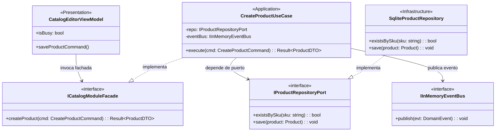
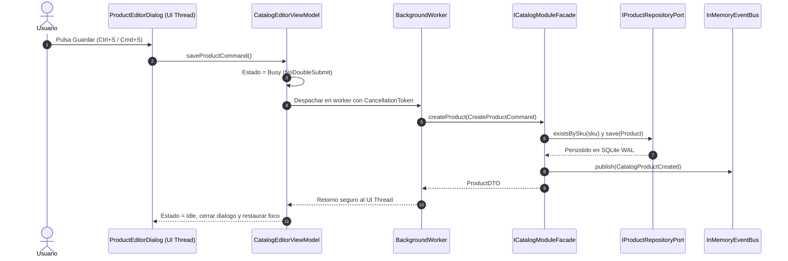

# Blueprint: Arquitectura Modular, Fronteras y Concurrencia

## 1. Diagrama de Modulos, Fachadas y Capas (Mermaid)



### Invariantes de Dominio Formales (OCL)

```ocl
context Product
inv ValidPositiveUnitPrice:
    self.unitPriceCents > 0

inv ArchivedProductReadOnly:
    self.status = ProductStatus::ARCHIVED implies
        self.unitPriceCents = self.unitPriceCents@pre
```

---

## 2. Diagrama de Secuencia: UI Thread, Fachada, Event Bus y Workers (Mermaid)



---

## 3. Catalogo de Modulos (`MOD-*`) y Reglas de Dependencia

| ID | Modulo | Responsabilidad | Fachada Publica | Persistencia Propia | Dependencias Permitidas | Estado |
| :--- | :--- | :--- | :--- | :--- | :--- | :--- |
| `MOD-CORE-001` | `core` | Configuración local, migraciones base y coordinación de arranque. | `ICoreModuleFacade` | `schema_migrations`, `app_preferences` | `none` | `Activo` |
| `MOD-CATALOG-001` | `catalog` | Gestión de catálogo local de productos y reglas de SKU. | `ICatalogModuleFacade` | `catalog_products` | `MOD-CORE-001` | `Activo` |

### Reglas Verificables de Frontera
- **`acyclic_modules: true`:** Prohibido crear ciclos entre módulos `MOD-*`.
- **`forbid_cross_module_internals: true`:** Prohibido importar repositorios, entidades internas o tablas de otro módulo fuera de su fachada pública o eventos del `InMemoryEventBus`.
- **`forbid_ui_direct_persistence: true`:** Prohibido importar conexiones SQLite o repositorios desde `View` o `ViewModel`.
- **Herramienta de Test de Arquitectura (`architecture_test_tool`):** `NetArchTest` / `import-linter` / `ArchUnit` / tests estructurales en el runner nativo.

---

## Historial de Revisiones (Últimos Cambios)

| Versión | Fecha | Requerimiento | Resumen del Cambio |
| :--- | :--- | :--- | :--- |
| `v0.1.0` | YYYY-MM-DD | `REQ-DESK-CORE-001` | Definición inicial de módulos `MOD-*`, fachadas, Event Bus y modelo de concurrencia. |

> *Nota: Esta tabla mantiene una ventana deslizante de los últimos 3 cambios. Para el historial completo, consultar `docs/backlog/changelog.md`.*
