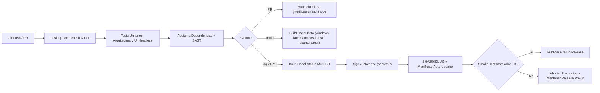

# Blueprint: Empaquetado Nativo, Firma y Release Multi-SO

## 1. Diagrama de Flujo del Pipeline Multi-SO (Mermaid)

---

## 2. Plataformas, Instaladores y Firma

| Plataforma (`target_platforms`) | Runner CI | Formato (`packaging_formats`) | Firma y Notarizacion (`signing_and_notarization`) |
| :--- | :--- | :--- | :--- |
| `windows` | `windows-latest` | `MSIX` / `WiX (.msi)` / `InnoSetup` | Authenticode con timestamp RFC 3161 (`secrets.SIGN_CERT_*`). |
| `macos` | `macos-latest` | `.dmg` / `.pkg` (Universal / arm64) | Developer ID + Hardened Runtime + `xcrun notarytool` + `stapler`. |
| `linux` | `ubuntu-latest` | `AppImage` / `Flatpak` / `.deb` | Firma GPG/minisign + `SHA256SUMS.asc`. |

---

## 3. Auto-Updater y Variables de Build (`auto_update` y `build_env_vars`)

- **Estrategia:** Descarga cifrada en segundo plano de paquete incremental o completo, verificación estricta de firma y SHA-256 antes de reemplazar binarios, y aplicación al reiniciar.
- **Canales:** `stable`, `beta`.
- **Politica de Recuperacion (`release_recovery_policy`):** Si la actualización falla en verificación o primer arranque, revertir al binario anterior sin alterar los datos en `%APPDATA%` / `Application Support` / `$XDG_DATA_HOME`.

| Variable / Secreto | Descripcion | `is_secret` | `ci_source` | Ambientes |
| :--- | :--- | :--- | :--- | :--- |
| `APP_UPDATE_CHANNEL` | Canal activo de actualización (`beta` \| `stable`) | `false` | `github_var` | `local`, `ci`, `beta`, `stable` |
| `SIGN_CERT_PFX_BASE64` | Certificado Authenticode Windows codificado en Base64 | `true` | `github_secret` | `ci`, `beta`, `stable` |
| `SIGN_CERT_PASSWORD` | Contraseña del certificado de firma Windows | `true` | `github_secret` | `ci`, `beta`, `stable` |
| `APPLE_DEVELOPER_CERT_BASE64` | Certificado Developer ID macOS (`.p12`) en Base64 | `true` | `github_secret` | `ci`, `beta`, `stable` |
| `APPLE_NOTARY_API_KEY` | Credencial de notarización para Apple Notary Service | `true` | `github_secret` | `ci`, `beta`, `stable` |

> **Regla Pre-Release:** Nunca versionar archivos `.pfx`, `.p12` ni `.keystore`. Antes de liberar un tag `vX.Y.Z`, auditar variables y secretos con `gh variable list --env <env>` y `gh secret list --env <env>`.

---

## Historial de Revisiones (Últimos Cambios)

| Versión | Fecha | Requerimiento | Resumen del Cambio |
| :--- | :--- | :--- | :--- |
| `v0.1.0` | YYYY-MM-DD | `REQ-DESK-REL-001` | Plantilla base de pipeline multi-SO, firma/notarización y *Auto-Updater*. |

> *Nota: Esta tabla mantiene una ventana deslizante de los últimos 3 cambios. Para el historial completo, consultar `docs/backlog/changelog.md`.*
