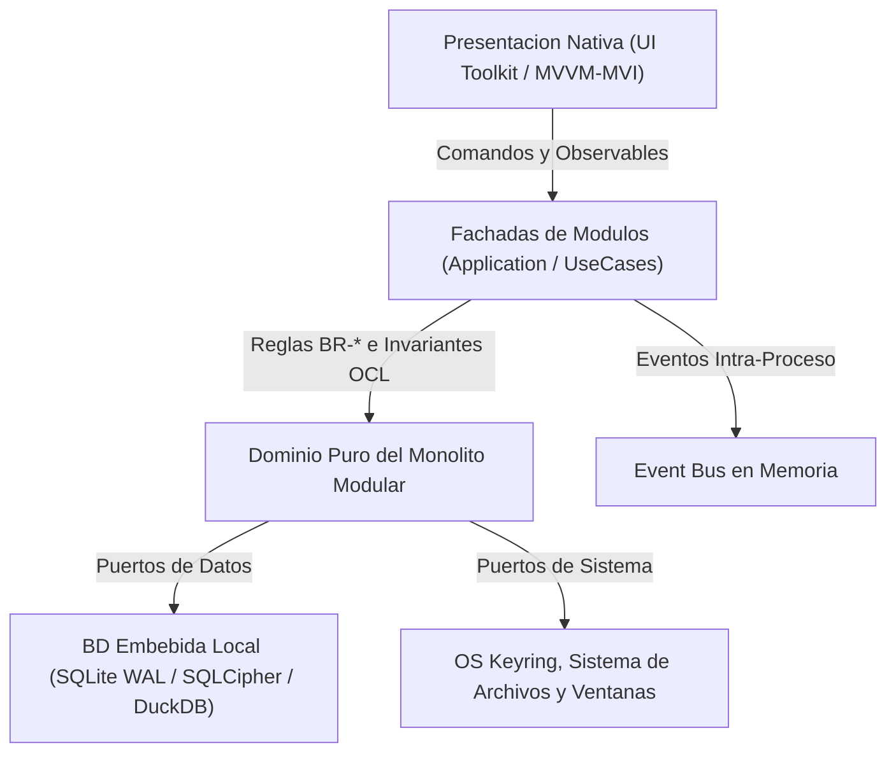

# Blueprint: Stack Tecnologico, Presupuestos y Politicas Locales Desktop

## 1. Matriz Multi-Ecosistema Nativo Soportada

| Familia | Ecosistemas Oficiales | Toolkit UI y Patron | Base de Datos Embebida y Keyring | Testing Unitario y UI |
| :--- | :--- | :--- | :--- | :--- |
| **`.NET Desktop`** | `wpf` \| `winui3` \| `avalonia` \| `maui-desktop` | XAML + MVVM (`CommunityToolkit.Mvvm`, ReactiveUI) | SQLite / SQLCipher + OS Credential Manager / Keychain | `xUnit` / `NUnit` + `Avalonia.Headless` / `FlaUI` |
| **`Python Desktop`** | `pyside6` \| `pyqt6` \| `flet` | Qt Widgets / QML + MVVM-MVP | SQLite WAL / DuckDB + `keyring` | `pytest` + `pytest-qt` |
| **`JVM Desktop`** | `compose-desktop` \| `javafx` | Compose Desktop / FXML + MVI-MVVM (`StateFlow`) | SQLite / SQLDelight / DuckDB + OS Keyring JNI | `JUnit 5` + Compose UI Test / `TestFX` |
| **`Rust / C++ Nativos`** | `rust-native` \| `qt-cpp` | Slint / Iced / Egui / Qt Quick (Elm / MVVM) | `rusqlite` / `sqlx` (SQLite) / Qt SQL + `keyring-rs` | `cargo test` / `GoogleTest` + `Qt Test` |

---

## 2. Diagrama de Capas del Stack Nativo (Mermaid)

---

## 3. Presupuestos Desktop (Performance Budgets)

| Metrica | Umbral Referencia | Estrategia de Cumplimiento |
| :--- | :--- | :--- |
| **`cold_startup_ms`** | `<= 1500 ms` | Carga diferida de módulos secundarios, migración rápida SQLite y compilación AOT / NativeAOT cuando aplique. |
| **`idle_ram_mb`** | `<= 250 MB` | Virtualización de listas largas, liberación determinista de buffers gráficos y caché acotada. |
| **`ui_frame_budget_ms`** | `<= 16 ms` | Prohibido ejecutar I/O en disco, SQL o cómputo pesado en el hilo UI; usar workers cancelables. |
| **`installer_max_mb`** | `<= 120 MB` | Trimming / tree-shaking de dependencias nativas sin empaquetar runtimes redundantes. |

---

## 4. Politicas de Seguridad Local y Higiene

- **Secretos (`local_secrets`):** Resguardar credenciales y llaves de cifrado exclusivamente en el *OS Keyring* nativo; prohibido guardar secretos en texto plano o en el binario compilado.
- **Path Traversal (`path_traversal`):** Canonizar toda ruta de entrada (CLI, *Drag & Drop*, *Deep Links*) y validar pertenencia a directorios/extensiones permitidas antes de leer o escribir.
- **Deserializacion (`deserialization`):** Usar parsers seguros con límite de tamaño y esquema estricto; prohibido deserializar formatos binarios inseguros (`pickle`, `BinaryFormatter`, Java `ObjectInputStream`).
- **Endurecimiento y Dependencias (`binary_hardening`):** Habilitar flags de seguridad de compilación y auditar vulnerabilidades mediante `gh api "repos/{owner}/{repo}/dependabot/alerts?state=open"` (`desktop-spec check --security`) y el auditor del ecosistema (`dotnet`, `pip-audit`, `cargo audit`, Gradle).
- **Internacionalizacion (i18n):** Centralizar literales de usuario en diccionarios o recursos nativos del toolkit sin textos quemados en el dominio.

---

## Historial de Revisiones (Últimos Cambios)

| Versión | Fecha | Requerimiento | Resumen del Cambio |
| :--- | :--- | :--- | :--- |
| `v0.1.0` | YYYY-MM-DD | `REQ-DESK-CORE-001` | Plantilla base de stack nativo, presupuestos desktop y seguridad local. |

> *Nota: Esta tabla mantiene una ventana deslizante de los últimos 3 cambios. Para el historial completo, consultar `docs/backlog/changelog.md`.*
