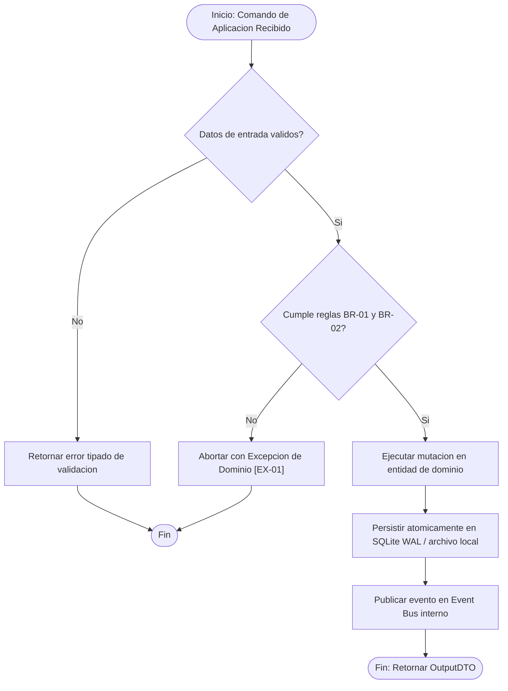

# UC-[MODULO]-[NUM]: [Nombre del Caso de Uso de Dominio]

## 1. Contexto, Actores y Precondiciones
- **Modulo:** `[core | catalog | ledger | sync]`
- **Actor Principal:** `[Operador Local | Worker en Segundo Plano | Modulo Invocador]`
- **Disparador (Trigger):** `[Comando de aplicacion en fachada del modulo o evento interno del Event Bus]`
- **Precondiciones:**
  - El almacenamiento local del modulo esta inicializado con `schema_version` compatible.
  - La entidad o agregado objetivo se encuentra en estado `[ESTADO_VALIDO]`.

---

## 2. Diagrama del Proceso de Negocio (Mermaid)


---

## 3. Contrato de Entrada y Salida (Agnostico de UI)

### Inputs Requeridos:
| Campo | Tipo | Obligatorio | Validaciones / Restricciones |
| :--- | :--- | :--- | :--- |
| `entityId` | String (UUID) | Si | Identificador no vacio de la entidad local |
| `amount` | Decimal | Si | Mayor a 0.00, precision exacta de 2 decimales |
| `note` | String | No | Maximo 240 caracteres UTF-8 sin caracteres de control |

### Output Esperado:
| Campo | Tipo | Descripcion |
| :--- | :--- | :--- |
| `operationId` | String (UUID) | Identificador unico de la operacion ejecutada |
| `resultingStatus` | String | Estado resultante de la entidad (`ACTIVE`, `FINALIZED` o `ARCHIVED`) |
| `updatedAtUtc` | ISO-8601 | Marca de tiempo UTC de confirmacion en almacenamiento local |

---

## 4. Reglas de Negocio Asociadas

- **[BR-01] [Nombre de la Regla Invariante de Operacion]:**
  - **Descripcion:** Descripcion explicita de la precondicion y postcondicion que el modulo debe garantizar antes de confirmar cambios.
  - **Contrato Formal OCL:**
    ```ocl
    context [ModuloService]::execute(input: [InputDTO])
    pre ValidAmount:
        input.amount > 0 and self.availableBalance >= input.amount
    post BalanceUpdated:
        self.availableBalance = self.availableBalance@pre - input.amount
    ```

- **[BR-02] [Invariante Permanente de Entidad]:**
  - **Descripcion:** Restriccion permanente sobre los estados permitidos de la entidad dentro del modulo.
  - **Contrato Formal OCL:**
    ```ocl
    context [EntidadDominio]
    inv ActiveEntityNotLocked:
        self.status = EntityStatus::ACTIVE implies self.isLocked = false
    ```

---

## 5. Efectos Secundarios Locales
- **Base de Datos Local (`local_database`):**
  - Insercion o actualizacion transaccional en la tabla `[nombre_tabla]` en SQLite (modo WAL).
- **Archivos Locales (`local_files`):**
  - Escritura atomica (archivo temporal + rename) en el directorio de proyecto si aplica, o `N/A`.
- **OS Keyring (`os_keyring`):**
  - Lectura o rotacion de credencial local en llavero del sistema operativo, o `N/A`.
- **Bus de Eventos Interno (`internal_domain_events`):**
  - Publicacion en memoria del evento `[Modulo].[Entidad]Updated(entityId, updatedAtUtc)`.

---

## 6. Flujos Alternativos y Excepciones de Dominio
- **[EX-01] `DomainValidationError`:** Si un campo incumple restricciones estructurales o `[BR-01]`, abortar antes de abrir transaccion de escritura.
- **[EX-02] `LocalPersistenceConflictError`:** Si falla el bloqueo de escritura en SQLite o archivo local bloqueado por otro proceso, revertir transaccion sin emitir evento interno.

---

## Historial de Revisiones (Ultimos Cambios)

| Version | Fecha | Requerimiento | Resumen del Cambio |
| :--- | :--- | :--- | :--- |
| `v0.1.0` | YYYY-MM-DD | `REQ-DESK-[MODULO]-001` | Creacion inicial del caso de uso de dominio. |

> *Nota: Esta tabla mantiene una ventana deslizante de los ultimos 3 cambios. Para el historial completo, consultar [`docs/backlog/changelog.md`](../../backlog/changelog.md).*
