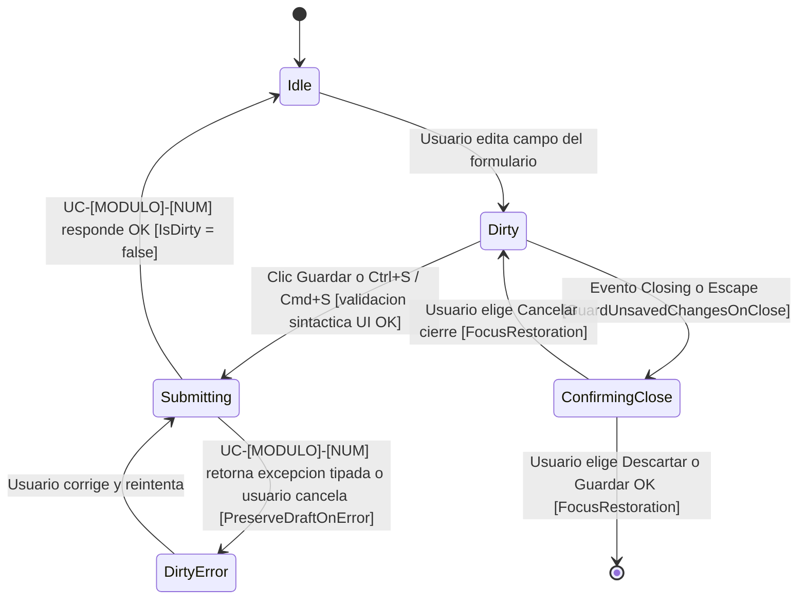

# UF-[MODULO]-[NUM]: [Nombre del Flujo de Interaccion Nativo]

## 1. Contexto, Ventana y Precondiciones
- **Modulo:** `[core | catalog | shell | settings]`
- **Actor Principal:** `[Operador Local | Usuario]`
- **Ventana / Vista Destino:** `[MainWindow | EditorDialog]` (`min_width_px: 640`, `min_height_px: 480`, `resizable: true`)
- **Disparador de Entrada:** `[Menu Archivo -> Nuevo, boton de barra de herramientas o atajo Ctrl+N / Cmd+N]`
- **Atajo Multiplataforma:** `Ctrl+S / Cmd+S`
- **Caso de Uso Delegado:** `UC-[MODULO]-[NUM]` (o `N/A`)
- **Precondiciones de Interfaz:**
  - La ventana padre esta activa y el espacio de trabajo local se encuentra cargado.
  - Si es un dialogo modal, conserva referencia al control disparador para restaurar foco al cerrar.

---

## 2. Diagrama del Flujo de Interaccion y FSM (Mermaid)


---

## 3. Entradas de Usuario y Salidas Visuales

### Eventos / Entradas del Usuario:
| Accion / Campo | Tipo | Obligatorio | Validacion UI |
| :--- | :--- | :--- | :--- |
| `titleInput` | Texto simple | Si | No vacio, longitud maxima 120 caracteres; mensaje inline al perder foco |
| `amountInput` | Entrada numerica | Si | Mascara decimal positiva; bloquea caracteres no numericos |
| `saveCommand` | Comando / Atajo | Si | Deshabilitado mientras `state == Submitting` o faltan campos requeridos |

### Salidas Visuales y Efectos:
| Elemento / Canal | Condicion | Comportamiento Esperado |
| :--- | :--- | :--- |
| `BusyIndicator` | `state == Submitting` | Muestra indicador no bloqueante en barra de estado y habilita boton Cancelar |
| `ErrorBanner` | Excepcion de `UC-*` | Presenta mensaje accionable en una linea y mueve foco al campo afectado |
| `StatusBar` | Operacion exitosa | Actualiza mensaje de confirmacion local y limpia indicador `*` de cambios sin guardar |

---

## 4. Matriz de Estados de Interfaz y Casos Borde

| Estado UI | Condicion de Disparo | Que ve el usuario | Accion / Recuperacion |
| :--- | :--- | :--- | :--- |
| **Loading / Busy** | Ejecucion de `UC-*` en worker en segundo plano | Indicador de progreso y comando Guardar deshabilitado; ventana sigue responsiva | Boton `Cancelar` interrumpe la tarea en background |
| **Empty** | Lista o panel sin registros locales | Mensaje operativo directo y accion primaria unica para crear primer elemento | Enfocar boton primario con `Enter` o clic |
| **Error de Dominio / Local** | `UC-*` retorna error tipado (`[EX-XX]`) | Banner legible con causa y sugerencia; borrador intacto sin borrar campos | Corregir entrada o pulsar `Reintentar` |
| **Dirty / ConfirmingClose** | Cierre con `hasUnsavedChanges == true` | Dialogo nativo tri-estado: *Guardar*, *Descartar cambios*, *Cancelar* | *Cancelar* retorna al editor conservando cambios y foco |

---

## 5. Invariantes de UI / Contratos (`ocl-ui`)

```ocl-ui
context UF_[MODULO]_[NUM]
inv NoDoubleSubmit:
    self.state = UIState::Submitting implies self.saveCommand.canExecute = false
inv PreserveDraftOnError:
    self.state = UIState::DirtyError implies self.formDraft = self.formDraft@pre
inv NoMainThreadBlock:
    self.state = UIState::Submitting implies self.isWorkerRunningOffUiThread = true
inv GuardUnsavedChangesOnClose:
    (self.hasUnsavedChanges = true and self.closeRequested = true) implies self.unsavedPromptVisible = true
```

---

## 6. Accesibilidad Nativa y Geometria
- **Foco Inicial y Teclado:** Al abrir `window_target`, el foco inicial recae en `titleInput`; al cerrar con `Escape` o `X`, `FocusRestoration` devuelve el foco al control disparador original.
- **Roles de Accesibilidad OS:** Cada control de entrada, boton de barra de herramientas y banner de error expone nombre y rol nativo (`AutomationProperties.Name` en XAML, `accessibleName` en Qt, `semantics { contentDescription }` en Compose) compatible con Narrator, VoiceOver y Orca.
- **Navegacion por Teclado:** Orden logico de tabulacion (`Tab` / `Shift+Tab`), flechas en listas y tablas, `Ctrl+S / Cmd+S` para guardar, `Escape` para cancelar o cerrar capas superpuestas y escalado limpio multi-DPI (`100%-200%`).

---

## Historial de Revisiones (Ultimos Cambios)

| Version | Fecha | Requerimiento | Resumen del Cambio |
| :--- | :--- | :--- | :--- |
| `v0.1.0` | YYYY-MM-DD | `REQ-DESK-[MODULO]-001` | Creacion inicial del flujo de interaccion nativo. |

> *Nota: Esta tabla mantiene una ventana deslizante de los ultimos 3 cambios. Para el historial completo, consultar [`docs/backlog/changelog.md`](../../backlog/changelog.md).*
