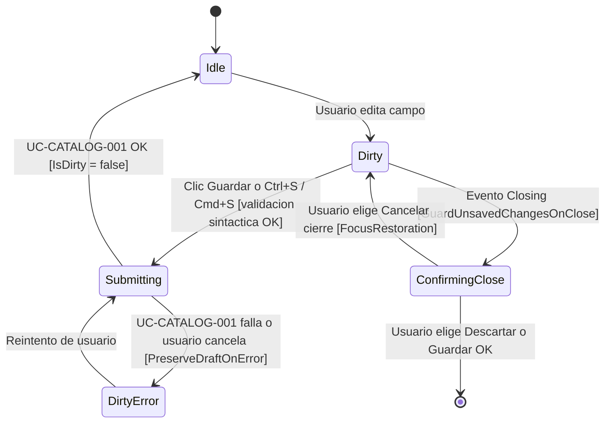

# Guia de Contratos UI y Matriz Heuristica FSM para Escritorio Nativo (`desktop-spec`)

Este documento establece el equivalente en la capa de presentacion (`View`, `Window`, `Dialog`, `ViewModel`/`Presenter`/`StateHolder`) a los contratos OCL de dominio: define cuando un flujo `UF-*` requiere obligatoriamente una **Maquina de Estados Finita (FSM)** e **invariantes verificables de UI (`ocl-ui`)**, y como traducirlos a pruebas nativas automatizadas.

---

## 1. Matriz Heuristica de Decision FSM e Invariantes

| Escenario Detectado | Condicion en el Requerimiento o Flujo | Accion Exigida al Agente |
| :--- | :--- | :--- |
| **Mutaciones Criticas o Exportaciones Pesadas** | Guardado definitivo, borrado irreversible, rotacion de claves en OS Keyring, importacion/exportacion masiva o generacion de archivos. | **OBLIGATORIO:** FSM `stateDiagram-v2` (`fsm_required: true`), `NoDoubleSubmit` y `NoMainThreadBlock` con cancelacion (`CancellationToken` / señal de aborto) si supera 150ms. |
| **Editores con Estado Sucio (*Dirty*) y Wizards** | Formularios de creacion/edicion, editores de documento local o asistentes multi-paso con validacion dependiente. | **OBLIGATORIO:** FSM con transiciones permitidas/prohibidas, `PreserveDraftOnError` y `GuardUnsavedChangesOnClose` al cerrar ventana, pestana o cambiar de proyecto. |
| **Espacios de Trabajo Densos y Dialogos Anidados** | Tablas virtualizadas (`DataGrid`) con filtros/ordenamiento, paneles divididos (*docking*), arboles de archivos, *Drag & Drop* del SO o modales secundarios. | **OBLIGATORIO:** FSM de interaccion, `FocusRestoration` al cerrar capas y contrato estricto de navegacion por teclado y roles de accesibilidad del SO (UIA / NSAccessibility / AT-SPI). |
| **Operaciones Optimistas o Workers en Background** | Actualizacion visual inmediata previa al commit local en SQLite/disco, indexacion en segundo plano o sincronizacion diferida. | **OBLIGATORIO:** FSM `Idle -> Busy/Cancellable -> Success | Cancelled | Error`, `NoMainThreadBlock` y `RollbackOnOptimisticFailure` si falla la persistencia. |
| **Vistas o Controles Presentacionales Puros** | Badges, separadores, barras de estado de solo lectura o dialogo estatico "Acerca de" sin efectos secundarios. | **OMITIR FSM:** Declarar `fsm_required: false` en el Frontmatter de `UF-*` y documentar unicamente estados visuales basicos (`normal`, `hover`, `focused`, `disabled`). |

---

## 2. Catalogo Estandar de los 6 Invariantes UI Verificables (`ocl-ui`)

Al redactar la seccion de contratos UI en `docs/functional/user-flows/UF-*.md`, utiliza los siguientes identificadores exactos para que puedan verificarse en pruebas de `ViewModel` y pruebas UI headless/automatizadas:

1. **`NoDoubleSubmit`:** Mientras la FSM se encuentre en estado `Submitting` o `Busy`, el comando o boton de confirmacion debe evaluarse como no ejecutable (`CanExecute == false` / `disabled == true`), ignorando clics repetidos, pulsaciones de `Enter` y repeticion de atajos (`Ctrl+S` / `Cmd+S`), garantizando una unica invocacion al caso de uso `UC-*`.
2. **`PreserveDraftOnError`:** Ante errores recuperables de dominio (`[EX-XX]`), bloqueo temporal de archivo o cancelacion por el usuario, todos los valores ingresados en los controles del formulario/editor (`Draft`) deben permanecer intactos respecto al estado previo al intento de ejecucion, mostrando el mensaje de error sin reiniciar ni limpiar los campos.
3. **`FocusRestoration`:** Al cerrar cualquier dialogo modal, popover, paleta de comandos o panel temporal (`Escape`, boton Cerrar/Cancelar o `X`), el foco del teclado del sistema operativo debe regresar exactamente al control disparador original en la ventana padre (o al siguiente elemento enfocable valido si el disparador dejo de existir).
4. **`RollbackOnOptimisticFailure`:** Si la vista o el `ViewModel` aplica una actualizacion optimista en pantalla antes de confirmar la escritura en SQLite o archivo local (ej. reordenar filas o marcar un item) y el `UC-*` devuelve error o falla el worker, la coleccion y estado visual observable deben revertirse exactamente al snapshot previo (`state@pre`) y notificar el motivo.
5. **`NoMainThreadBlock`:** Ninguna operacion de E/S en disco, consulta pesada a SQLite, cifrado, lectura de archivos grandes o calculo > 16ms (presupuesto de frame a 60fps) puede ejecutarse sincronamente en el **UI Thread** (`Dispatcher` / hilo principal de `QApplication` / `Main` thread). Debe ejecutarse en un worker en segundo plano manteniendo la ventana responsiva para mover, redimensionar o cancelar, publicando el resultado de vuelta al hilo UI de forma segura.
6. **`GuardUnsavedChangesOnClose`:** Mientras `hasUnsavedChanges == true`, cualquier intento de cerrar la ventana (`Window.Closing` / `QCloseEvent`), cerrar una pestana de documento, cambiar de elemento activo o salir de la aplicacion (`Alt+F4` / `Cmd+Q`) debe interceptarse antes de destruir el estado y ofrecer confirmacion tri-estado (*Guardar*, *Descartar cambios*, *Cancelar*), cancelando el cierre si el usuario elige *Cancelar* o si el guardado falla.

---

## 3. Tabla de Traduccion a Tests Nativos

| Invariante | `xUnit` + `Avalonia.Headless` / `FlaUI` (.NET) | `pytest` + `pytest-qt` (Python) | `JUnit 5` + `Compose UI Test` (JVM) |
| :--- | :--- | :--- | :--- |
| **`NoDoubleSubmit`** | Simular `TaskCompletionSource` pendiente en `UC-*`; pulsar 2 veces con `window.KeyPressQwerty(PhysicalKey.Enter)` o clic en boton; verificar `Assert.False(vm.SaveCommand.CanExecute(null))`, `Assert.False(saveBtn.IsEnabled)` y `useCaseMock.Verify(..., Times.Once)`. | Con `qtbot.mouseClick(save_btn, Qt.LeftButton)` doble mientras el worker esta bloqueado: verificar `not save_btn.isEnabled()` y que la senal/spy del caso de uso se emitio exactamente `1` vez. | Con `composeTestRule.onNodeWithTag("saveBtn")`: tras el primer `performClick()`, verificar `assertIsNotEnabled()`, repetir `performClick()` y afirmar `invokeCount == 1`. |
| **`PreserveDraftOnError`** | Disparar `SaveCommand` con `UC-*` retornando `DomainRuleException`; verificar `Assert.Equal("Valor previo", titleBox.Text)` y visibilidad del `ErrorBanner` con mensaje legible. | Simular senal de error del worker con `qtbot.waitSignal(vm.failed)`; verificar `assert title_input.text() == "Valor previo"` y `assert error_label.isVisible()`. | Simular fallo en el caso de uso fake; verificar `onNodeWithTag("titleInput").assertTextEquals("Valor previo")` y `onNodeWithTag("errorBanner").assertIsDisplayed()`. |
| **`FocusRestoration`** | Abrir dialogo desde `openBtn`; verificar foco dentro del dialogo; enviar `PhysicalKey.Escape` con `Dispatcher.UIThread.RunJobs()`; verificar `Assert.True(openBtn.IsFocused)` (o `AutomationElement.HasKeyboardFocus` en FlaUI). | Abrir dialogo con `qtbot.mouseClick(open_btn, Qt.LeftButton)`; enviar `qtbot.keyClick(dialog, Qt.Key_Escape)`; verificar `qtbot.waitUntil(lambda: open_btn.hasFocus())`. | Abrir dialogo desde `onNodeWithTag("openBtn")`; enviar `performKeyInput { pressKey(Key.Escape) }`; verificar `onNodeWithTag("openBtn").assertIsFocused()`. |
| **`RollbackOnOptimisticFailure`** | Capturar orden inicial de `ObservableCollection`; mover item optimista mientras `UC-*` falla async; tras `RunJobs()`, verificar que el orden y propiedades coinciden con el snapshot previo y existe aviso de error. | Guardar `initial_items` antes de mutar el modelo Qt; emitir fallo desde el caso de uso; tras `qtbot.waitUntil(...)`, verificar que `model.items() == initial_items` y el aviso de reversion es visible. | Capturar lista inicial en `StateFlow`; disparar accion optimista con caso de uso que retorna `Result.failure`; tras `composeTestRule.waitForIdle()`, verificar lista restaurada en pantalla. |
| **`NoMainThreadBlock`** | Medir en `Dispatcher.UIThread` que el comando retorna antes de completar el `Task` en background (`< 16ms`), `IsBusy == true` es observable de inmediato y `CancelCommand` interrumpe el `CancellationToken` del worker. | Iniciar worker en `QThread`/`QThreadPool`; verificar que `QApplication.processEvents()` responde en `< 16ms`, `busy_indicator.isVisible()` y `qtbot.mouseClick(cancel_btn, Qt.LeftButton)` cancela la tarea. | Lanzar tarea con `Dispatchers.IO`; usar `composeTestRule.mainClock` o comprobar que la UI responde a interacciones y boton Cancelar mientras `isBusy == true` antes de completar el `CompletableDeferred`. |
| **`GuardUnsavedChangesOnClose`** | Modificar campo (`IsDirty == true`), invocar `window.Close()` con evento `Closing`; verificar que `e.Cancel == true` mientras el prompt de confirmacion esta abierto; elegir "Cancelar" y verificar que la ventana sigue abierta. | Marcar formulario como dirty, llamar `window.close()`; interceptar dialogo de confirmacion o `QCloseEvent`, verificar `not event.isAccepted()` al cancelar y `window.isVisible()`. | Con `isDirty == true`, disparar accion de cierre (`onCloseRequest`); verificar que se muestra el dialogo `unsavedChangesDialog` con botones Guardar/Descartar/Cancelar y que la ventana permanece activa al cancelar. |

> **Nota para otros ecosistemas nativos:** En **JavaFX (`TestFX`)** utiliza `FxRobot` (`clickOn`, `push(KeyCode.ESCAPE)`, `verifyThat("#saveBtn", NodeMatchers.isDisabled())`). En **Qt C++ (`Qt Test`)** utiliza `QTest::mouseClick`, `QTest::keyClick` y `QSignalSpy`. En **Rust (`slint::testing` / `egui_kittest`)** simula eventos sobre el adapter headless y verifica propiedades reactivas y conteo de llamadas al puerto de dominio.

---

## 4. Ejemplo de Contrato `stateDiagram-v2` + `ocl-ui` en un `UF-*.md`



```ocl-ui
context UF_CATALOG_001
inv NoDoubleSubmit:
    self.state = UIState::Submitting implies self.saveCommand.canExecute = false
inv PreserveDraftOnError:
    self.state = UIState::DirtyError implies self.formDraft = self.formDraft@pre
inv NoMainThreadBlock:
    self.state = UIState::Submitting implies self.isWorkerRunningOffUiThread = true
inv GuardUnsavedChangesOnClose:
    (self.isDirty = true and self.closeRequested = true) implies self.unsavedPromptVisible = true
```
