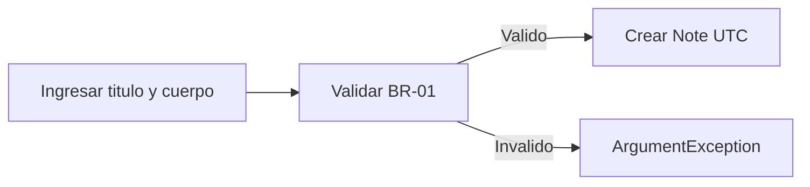

# UC-NOTES-001: Crear nota

## 1. Descripcion
Permite al usuario crear y persistir una nota local con titulo obligatorio y cuerpo opcional desde la ventana principal de `SampleNotes`.

## 2. Reglas de Negocio
- `[BR-01]` El titulo de la nota es obligatorio, no puede estar vacio ni compuesto solo por espacios en blanco, y su longitud maxima recortada es de 120 caracteres.
- `[BR-02]` El cuerpo de la nota es opcional; si se omite o es nulo, se normaliza a cadena vacia.
- `[BR-03]` Toda nota creada recibe un identificador `Guid` unico no vacio y marca temporal `CreatedAtUtc` en UTC.

## 3. Contratos OCL
```ocl
context CreateNoteUseCase::CreateAsync(title: String, body: String)
pre: title <> null and title.trim().size() >= 1 and title.trim().size() <= 120
post: result.Id <> null and result.Title = title.trim() and result.CreatedAtUtc <> null
```

## 4. Diagrama de Proceso


## 5. Trazabilidad
- Interfaz de modulo: `src/Modules/Notes/INotesModule.cs`
- Entidad: `src/Modules/Notes/Note.cs`
- Caso de uso: `src/Modules/Notes/CreateNoteUseCase.cs`
- Pruebas: `tests/Notes/CreateNoteTests.cs`
