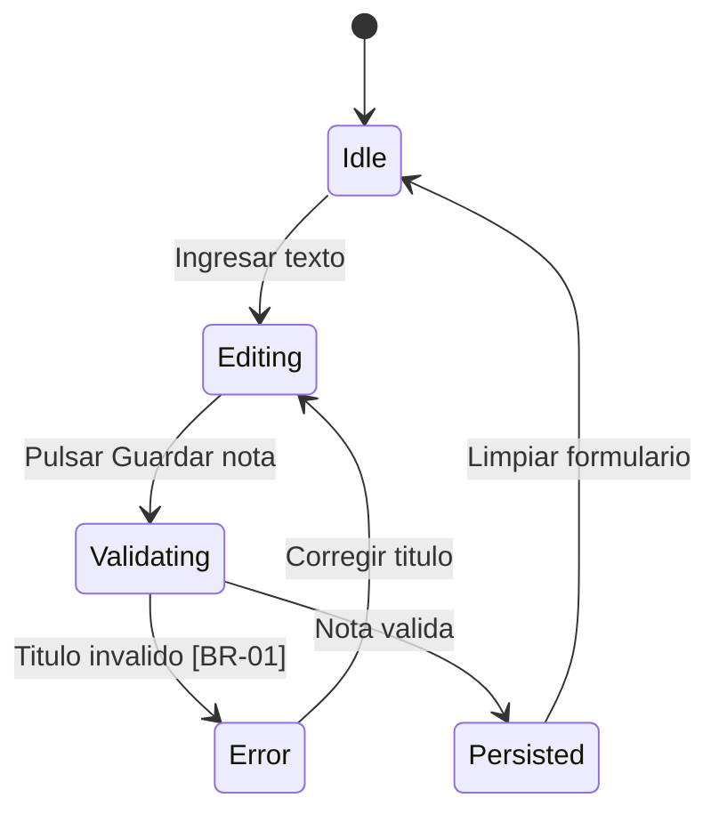

# UF-NOTES-001: Flujo de creacion de nota

## 1. Maquina de Estados (FSM)

## 2. Matriz de Estados UI
| Estado | Boton Guardar | Campo Titulo | Mensaje de Estado |
| :--- | :--- | :--- | :--- |
| `Idle` | Habilitado | Vacio, foco inicial | Listo para crear nota |
| `Editing` | Habilitado | Con texto | Editando borrador |
| `Validating` | Deshabilitado | Solo lectura | Validando reglas |
| `Error` | Habilitado | Borde de error semantico | Titulo obligatorio |
| `Persisted` | Habilitado | Limpio | Nota guardada |

## 3. Accesibilidad y Geometria Desktop
- Ventana principal: `960x640` por defecto, minimo `640x480`.
- Navegacion por teclado: `Tab` recorre Titulo -> Contenido -> Guardar nota; `Ctrl+S` dispara el guardado.
- Contraste minimo WCAG AA en todos los temas (`light`, `dark`, `system`, `high-contrast`).
- Vista asociada: `src/Views/MainWindow.axaml`.
