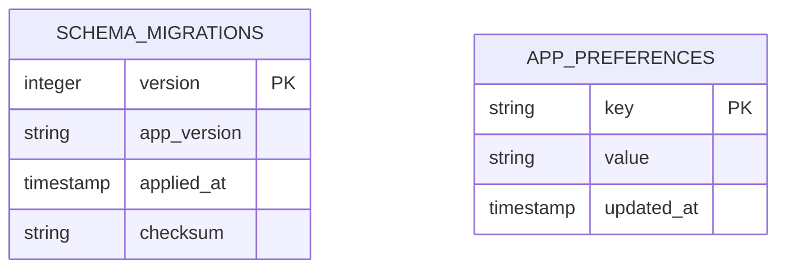

# Persistencia Local, Rutas del SO y Migraciones — sample-dotnet-desktop

## 1. Rutas Estandar del Sistema Operativo (`os_data_paths`)

| Proposito | Windows | macOS | Linux (XDG) | Politica |
| :--- | :--- | :--- | :--- | :--- |
| **Datos Persistentes (`data_dir_policy`)** | `%APPDATA%\sample-dotnet-desktop\data` | `~/Library/Application Support/sample-dotnet-desktop/data` | `$XDG_DATA_HOME/sample-dotnet-desktop` | Aloja la base embebida (`SQLite (WAL)`), configuraciones de usuario y respaldos de migración. |
| **Cache Regenerable (`cache_dir_policy`)** | `%LOCALAPPDATA%\sample-dotnet-desktop\cache` | `~/Library/Caches/sample-dotnet-desktop` | `$XDG_CACHE_HOME/sample-dotnet-desktop` | Miniaturas, índices temporales y cachés descartables con límite de cuota. |
| **Logs Rotativos (`logs_dir_policy`)** | `%LOCALAPPDATA%\sample-dotnet-desktop\logs` | `~/Library/Logs/sample-dotnet-desktop` | `$XDG_STATE_HOME/sample-dotnet-desktop/logs` | Bitácora estructurada rotativa (máximo 5 archivos), sin secretos ni PII sensible. |

---

## 2. Diagrama Entidad-Relacion (Mermaid)

---

## 3. Diccionario de Datos Embebido (`SQLite (WAL)`)

### Tabla: `schema_migrations`
- **Modulo Propietario:** `core`
- **Descripcion:** Registra el historial inmutable de migraciones aplicadas en la base local para validar compatibilidad al arranque.

| Campo | Tipo | Nulo | Por Defecto | Clave | Descripcion |
| :--- | :--- | :--- | :--- | :--- | :--- |
| `version` | `INTEGER` | NO | - | PK | Número secuencial incremental de la migración |
| `app_version` | `TEXT` | NO | - | - | Versión de la aplicación que ejecutó la migración |
| `applied_at` | `TEXT` | NO | `CURRENT_TIMESTAMP` | - | Marca de tiempo UTC ISO-8601 |
| `checksum` | `TEXT` | NO | - | - | Hash SHA-256 del script o definición de migración |

### Tabla: `app_preferences`
- **Modulo Propietario:** `core`
- **Descripcion:** Preferencias no sensibles del usuario (tema, densidad, geometría de ventana). Prohibido almacenar credenciales aquí.

| Campo | Tipo | Nulo | Por Defecto | Clave | Descripcion |
| :--- | :--- | :--- | :--- | :--- | :--- |
| `key` | `TEXT` | NO | - | PK | Clave única de preferencia local |
| `value` | `TEXT` | NO | - | - | Valor serializado en formato plano o JSON validado |
| `updated_at` | `TEXT` | NO | `CURRENT_TIMESTAMP` | - | Última actualización UTC |

---

## 4. Formatos de Archivos de Proyecto (`project_file_formats`)

| Extension | Formato | Campo de Version | Escritura Atomica (`atomic_write`) | Descripcion |
| :--- | :--- | :--- | :--- | :--- |
| `N/A` | Pendiente de definir | `schema_version` | `true` | Si el producto exporta/abre archivos propios, usar escritura atómica (archivo temporal + `fsync` + reemplazo). |

---

## 5. Estrategia de Migraciones On-Startup (`migration_strategy`)

- **Herramienta de Migracion (`tool`):** Migrador nativo del ecosistema para `SQLite (WAL)` (ej. EF Core Migrations, Alembic, Flyway/SQLDelight, `sqlx::migrate` o runner SQL transaccional versionado).
- **Disparador (`run_trigger`):** Ejecución síncrona controlada durante la fase de arranque (`AppStartup`) antes de habilitar escrituras en los módulos de dominio.
- **Respaldo Previo (`pre_migration_backup: true`):** Obligatorio copiar un snapshot verificado del archivo de base de datos (`*.db.bak-<version>`) antes de aplicar cualquier migración pendiente.
- **Verificacion de Version (`schema_version_check`):** Si el archivo local declara una `schema_version` superior a la soportada por el binario actual, abortar la apertura sin modificar datos y reportar error de compatibilidad.
- **Politica de Recuperacion (`recovery_policy`):** Si una migración falla, revertir la transacción y restaurar automáticamente el snapshot previo antes de mostrar el diagnóstico de recuperación al usuario.

---

## Historial de Revisiones (Últimos Cambios)

| Versión | Fecha | Requerimiento | Resumen del Cambio |
| :--- | :--- | :--- | :--- |
| `v0.1.0` | 2026-11-24 | `INIT` | Configuración base de `SQLite (WAL)`, rutas por SO y migraciones *on-startup* con respaldo. |

> *Nota: Esta tabla mantiene una ventana deslizante de los últimos 3 cambios. Para el historial completo, consultar [`docs/backlog/changelog.md`](../backlog/changelog.md).*
