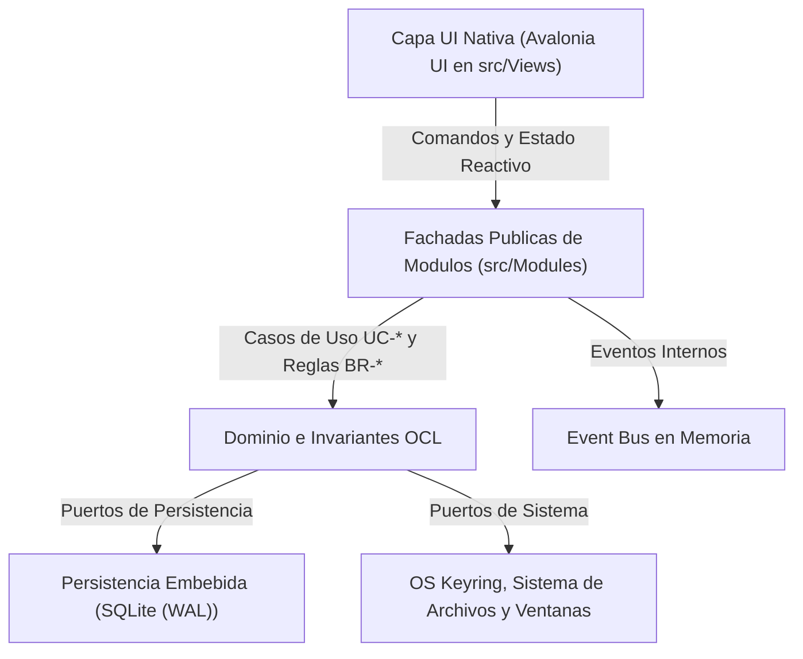

# Stack Tecnologico, Presupuestos y Politicas Locales — sample-dotnet-desktop

## 1. Nucleo Tecnologico Nativo

<!-- SYNC:TECH_STACK:START -->
| Componente | Tecnologia Seleccionada | Manifiesto / Configuracion | Responsabilidad |
| :--- | :--- | :--- | :--- |
| **Ecosistema y Lenguaje** | `Avalonia UI (.NET)` (`C#` / `dotnet`) | `app.csproj` (`v0.1.0`) | Runtime nativo compilado o empaquetado de proceso único. |
| **Toolkit UI y Patron** | `Avalonia UI` | `src/Views` | Ventanas, controles nativos, binding reactivo y accesibilidad del SO. |
| **Arquitectura** | Monolito Modular (MVVM / MVI + Clean) | `src/Modules` | Aislamiento estricto por módulos `MOD-*` con fachadas públicas. |
| **Base de Datos Embebida** | `SQLite (WAL)` | Modo local con migraciones *on-startup* | Persistencia transaccional local en disco del usuario. |
| **Resguardo de Secretos** | OS Keyring Nativo (Credential Manager / Keychain / Secret Service) | Proveedor nativo del SO | Almacenamiento cifrado de llaves locales, tokens o claves de proyecto. |
| **Testing Unitario y UI** | `xUnit` + `Avalonia.Headless` | `tests/{slug_pascal}Tests.cs` | Pruebas de dominio, fronteras modulares y UI *headless* / automatización nativa. |
<!-- SYNC:TECH_STACK:END -->

---

## 2. Mapa de Capas del Stack Nativo (Mermaid)

---

## 3. Convenciones de Codigo y Estructura

- **Codigo Fuente Principal:** `src`
- **Capa de Vistas / Presentacion:** `src/Views`
- **Modulos de Dominio:** `src/Modules`
- **Patron de Pruebas:** `tests/{slug_pascal}Tests.cs`
- **Nomenclatura:** Clases, tipos, ViewModels y entidades en `PascalCase`; constantes de configuración en `UPPER_SNAKE_CASE`.

---

## 4. Presupuestos Desktop (Performance Budgets)

| Metrica | Umbral Objetivo | Politica de Verificacion |
| :--- | :--- | :--- |
| **`cold_startup_ms`** | `<= 1500 ms` | Medición desde lanzamiento del binario hasta primera ventana interactiva (*First Interactive Frame*). |
| **`idle_ram_mb`** | `<= 250 MB` | Consumo residente en reposo tras inicializar el módulo principal sin fugas de memoria o handles. |
| **`ui_frame_budget_ms`** | `<= 16 ms` | Renderizado estable a >= 60 FPS; cero operaciones síncronas bloqueantes en el hilo UI. |
| **`installer_max_mb`** | `<= 120 MB` | Tamaño máximo del instalador o paquete nativo distribuido por plataforma. |

---

## 5. Politicas de Seguridad Local y Mantenimiento

- **Resguardo de Secretos (`local_secrets`):** Prohibido almacenar llaves privadas, contraseñas o credenciales en archivos planos, configuración local ni dentro del binario compilado. Usar exclusivamente el *OS Keyring* nativo del sistema operativo.
- **Prevencion de Path Traversal (`path_traversal`):** Toda ruta recibida por argumentos CLI, *Drag & Drop*, *Deep Links* o archivos recientes debe canonizarse (`realpath` / `Path.GetFullPath`) y validarse contra el directorio o extensión autorizada antes de abrirla o escribirla.
- **Deserializacion Segura (`deserialization`):** Prohibido deserializar formatos binarios inseguros o polimórficos arbitrarios al leer archivos de proyecto o estado local; usar esquemas estrictos y validación de tamaño máximo.
- **Endurecimiento y Higiene de Dependencias (`binary_hardening`):** Mantener auditoría de dependencias activa mediante `gh api "repos/{owner}/{repo}/dependabot/alerts?state=open"` (`desktop-spec check --security` / `dspec check --security`) y el auditor nativo del ecosistema (`dotnet list package --vulnerable`, `pip-audit`, `cargo audit`, o verificación Gradle). Toda remediación se traza bajo `REQ-DESK-SEC-*`.
- **Internacionalizacion (i18n):** Centralizar cadenas visibles al usuario en recursos de localización nativos del toolkit sin concatenación manual en el dominio.

---

## Historial de Revisiones (Últimos Cambios)

| Versión | Fecha | Requerimiento | Resumen del Cambio |
| :--- | :--- | :--- | :--- |
| `v0.1.0` | 2026-11-24 | `INIT` | Configuración base del stack nativo `Avalonia UI (.NET)`, presupuestos desktop y seguridad local. |

> *Nota: Esta tabla mantiene una ventana deslizante de los últimos 3 cambios. Para el historial completo, consultar [`docs/backlog/changelog.md`](../backlog/changelog.md).*
