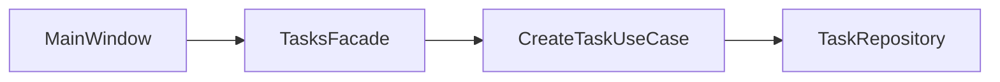

# UC-TASKS-001: Create Task

## Resumen
Permite al usuario crear una nueva tarea de escritorio dentro del modulo `tasks`, validando el titulo ingresado y persistiendo el estado inicial de la tarea.

## Actor Principal
Usuario de escritorio.

## Precondiciones
- La ventana principal (`MainWindow`) esta inicializada y conectada a `TasksFacade`.

## Flujo Principal



1. El usuario ingresa un titulo en el campo `Task title`.
2. El usuario acciona el boton `Create Task`.
3. `TasksFacade.create_task` delega la ejecucion en `CreateTaskUseCase.execute`.
4. El caso de uso normaliza espacios extremos y valida `[BR-01]`.
5. Se genera un identificador secuencial `task-NNN` y se guarda la tarea en `TaskRepository`.
6. La interfaz agrega la tarea a `Task list` y actualiza `status_label`.

## Reglas de Negocio
- `[BR-01]` El titulo de la tarea (una vez recortados los espacios iniciales y finales) debe tener entre 1 y 120 caracteres. Si es vacio o excede 120 caracteres, se rechaza con `ValueError`.

## Invariantes y Contratos OCL
```ocl
context CreateTaskUseCase::execute(request: CreateTaskRequest): CreateTaskResult
pre: request.title.trim().size() >= 1 and request.title.trim().size() <= 120
post: result.title = request.title.trim()
post: result.completed = false
post: repository.list_all()->includes(result)
```

## Postcondiciones
- La tarea creada queda disponible en `TasksFacade.list_tasks()` con `completed = False`.
