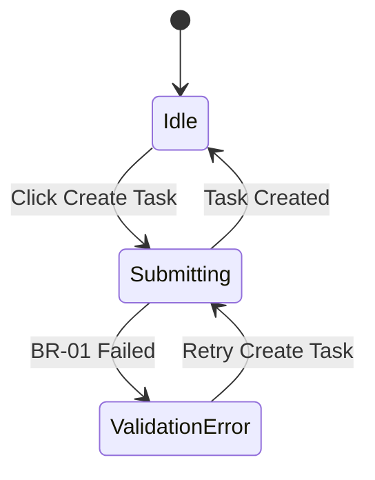

# UF-TASKS-001: Create Task Flow

## Resumen
Flujo de interaccion en `MainWindow` para capturar el titulo de una tarea, invocar `UC-TASKS-001` y reflejar el resultado en la lista y barra de estado.

## Maquina de Estados Finitos (FSM)

## Matriz de Estados UI

| Estado | `title_input` | `create_button` | `status_label` | `task_list` |
| :--- | :--- | :--- | :--- | :--- |
| `Idle` | Habilitado, foco disponible | Habilitado | `Ready` | Muestra tareas existentes |
| `Submitting` | Lectura temporal | Deshabilitado durante ejecucion | Procesando | Sin cambios |
| `ValidationError` | Habilitado con texto actual | Habilitado | Mensaje de error `[BR-01]` | Sin cambios |
| `TaskCreated` | Limpio (`""`) | Habilitado | `Created task-NNN` | Agrega `[task-NNN] <title>` |

## Accesibilidad y Geometria
- **Accesibilidad**:
  - `title_input` define `accessibleName = "Task title"`.
  - `create_button` define `accessibleName = "Create task"`.
  - `task_list` define `accessibleName = "Task list"`.
  - Navegacion por teclado mediante `Tab` entre `title_input`, `create_button` y `task_list`.
- **Geometria Desktop**:
  - Ventana minima `640x420` px (`setMinimumSize(640, 420)`).
  - Margen del contenedor raiz: `16px` en los cuatro lados.
  - Espaciado vertical entre secciones: `12px`; espaciado horizontal en fila de entrada: `8px`.
