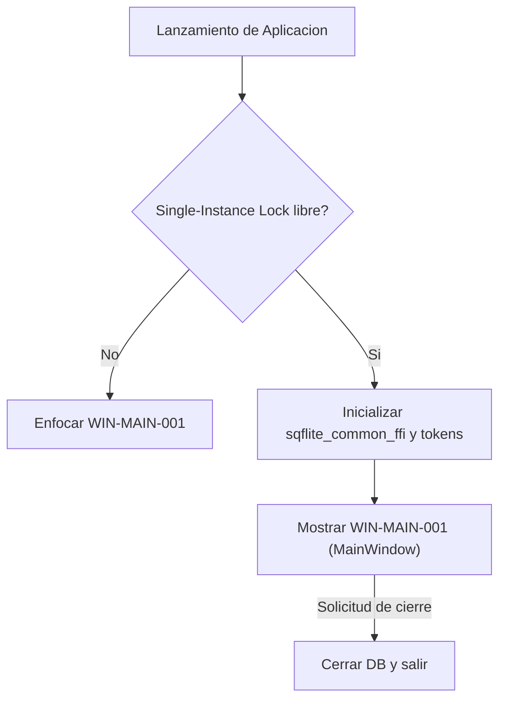

# Topologia de Ventanas y Contratos con el Sistema Operativo — sample-flutter-desktop

## 1. Diagrama de Ciclo de Vida de Ventanas y Arranque (Mermaid)

---

## 2. Politica de Instancia Unica (`single_instance_policy`)

- **Habilitada (`enabled`):** `true`
- **Mecanismo IPC Local:** Named Pipes (Windows) / Unix Domain Sockets (macOS/Linux).

---

## 3. Inventario de Ventanas y Dialogos (`WIN-*`)

| ID | Nombre | Flujo (`UF-*`) | Rol | Geometria Minima (px) | Guardia Cambios (`unsaved_changes_guard`) | Comportamiento al Cerrar |
| :--- | :--- | :--- | :--- | :--- | :--- | :--- |
| `WIN-MAIN-001` | `MainWindow` | `UF-TASKS-001` | `main` | `1024 x 680` | `true` | Persiste estado y cierra el proceso. |

---

## 4. Mapa de Comandos Globales y Atajos de Teclado

| Accion | Windows / Linux | macOS | Alcance (`scope`) |
| :--- | :--- | :--- | :--- |
| Crear tarea | `Ctrl+N` | `Cmd+N` | `WIN-MAIN-001` |
| Salir de la aplicacion | `Alt+F4` / `Ctrl+Q` | `Cmd+Q` | Global |

---

## 5. Contratos de Integracion con el Sistema Operativo (`os_integrations`)

- **Permisos del SO (`os_permissions`):** Operacion estándar en espacio de usuario sin elevación de privilegios.

### Contratos IPC / FFI (Opcional)

`none` (aplicación nativa Flutter Desktop sin puente WebView; acceso a SQLite via `sqflite_common_ffi` encapsulado en el módulo de persistencia).

---

## Historial de Revisiones (Últimos Cambios)

| Versión | Fecha | Requerimiento | Resumen del Cambio |
| :--- | :--- | :--- | :--- |
| `v0.1.0` | 2026-11-24 | `INIT` | Definición inicial de ventana principal `WIN-MAIN-001` para Flutter Desktop. |

> *Nota: Esta tabla mantiene una ventana deslizante de los últimos 3 cambios. Para el historial completo, consultar [`docs/backlog/changelog.md`](../backlog/changelog.md).*
