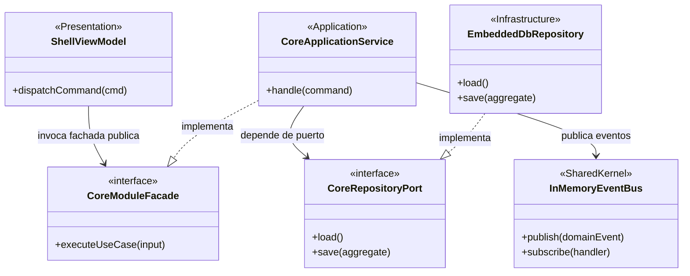
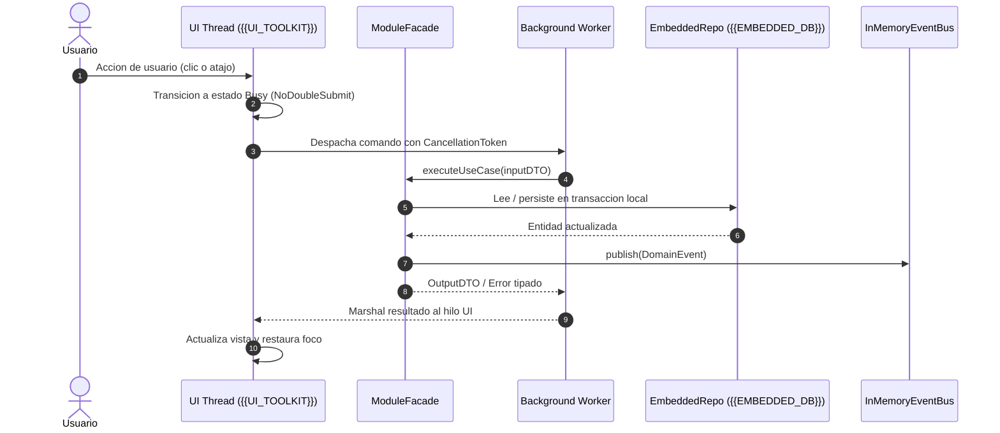

# Arquitectura Modular, Fronteras y Concurrencia — {{PROJECT_NAME}}

## 1. Diagrama de Modulos y Dependencias (Mermaid)

### Invariantes de Dominio Formales (OCL)
_Las invariantes `inv` de entidades y agregados complejos se documentan aquí siguiendo [`.spec/templates/ocl-guidelines.md`](../../.spec/templates/ocl-guidelines.md) y en sus respectivos casos de uso `UC-*`._

---

## 2. Diagrama de Secuencia: UI Thread, Event Bus y Background Workers (Mermaid)

---

## 3. Catalogo de Modulos de Dominio (`MOD-*`)

| ID | Modulo | Responsabilidad | Fachada Publica | Alcance de Persistencia | Dependencias Permitidas | Estado |
| :--- | :--- | :--- | :--- | :--- | :--- | :--- |
| `MOD-CORE-001` | `core` | Núcleo inicial de dominio y coordinación base de la aplicación. | `ICoreModuleFacade` | Tablas base en `{{EMBEDDED_DB}}` | `none` | `Borrador` |

---

## 4. Reglas de Dependencia, Event Bus y Concurrencia

### A. Reglas de Frontera Arquitectonica (`dependency_rules`)
- **`acyclic_modules: true`:** El grafo de dependencias entre módulos `MOD-*` es estrictamente acíclico.
- **`forbid_cross_module_internals: true`:** Un módulo solo puede invocar la fachada pública o escuchar eventos publicados de otro módulo; prohibido importar entidades internas, repositorios o helpers privados ajenos.
- **`forbid_ui_direct_persistence: true`:** La capa UI (`{{UI_DIR}}`) nunca importa clientes de `{{EMBEDDED_DB}}`, SQL ni acceso directo a archivos de dominio; toda mutación o lectura pasa por una fachada pública y un `UC-*`.
- **Verificacion Automatizada (`architecture_test_tool`):** Configurar pruebas de arquitectura nativas (`NetArchTest`, `import-linter`, `ArchUnit` o tests de módulo en `{{UNIT_TEST_RUNNER}}`) ejecutadas en CI y `pre-commit`.

### B. Event Bus en Memoria (`internal_event_bus`)
- **Mecanismo:** Bus de eventos tipados en memoria intra-proceso (`InMemoryEventBus`).
- **Garantia de Entrega:** Entrega síncrona o asíncrona despachada en el mismo proceso con manejo aislado de excepciones por suscriptor para no corromper la transacción del publicador.
- **Despacho Asincrono (`async_dispatch: true`):** Los manejadores que realicen E/S local corren en workers dedicados sin bloquear el hilo de interfaz.

### C. Modelo de Concurrencia (`concurrency_model`)
- **Politica del Hilo UI (`ui_thread_policy`):** El hilo principal de `{{UI_TOOLKIT}}` queda reservado exclusivamente para renderizado, eventos de entrada y actualización de estado observable; cero I/O bloqueante.
- **Mecanismo de Workers (`background_worker_mechanism`):** Tareas asíncronas nativas del ecosistema (`Task.Run` / `async-await`, `QThreadPool` / `asyncio`, corrutinas `Dispatchers.IO`, o `tokio` / threads dedicados) con retorno seguro al dispatcher UI.
- **Soporte de Cancelacion (`cancellation_support: true`):** Toda operación de larga duración recibe un token o señal de cancelación vinculada al ciclo de vida de la ventana o comando del usuario.

---

## Historial de Revisiones (Últimos Cambios)

| Versión | Fecha | Requerimiento | Resumen del Cambio |
| :--- | :--- | :--- | :--- |
| `v{{CURRENT_VERSION}}` | {{TODAY}} | `INIT` | Estructura base del monolito modular, reglas acíclicas, Event Bus y concurrencia. |

> *Nota: Esta tabla mantiene una ventana deslizante de los últimos 3 cambios. Para el historial completo, consultar [`docs/backlog/changelog.md`](../backlog/changelog.md).*
