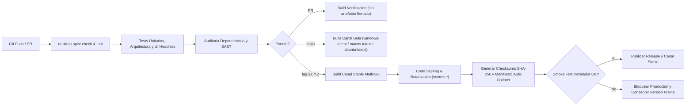

# Empaquetado Nativo, Firma y Release Multi-SO — {{PROJECT_NAME}}

## 1. Diagrama del Pipeline CI/CD Multi-SO (Mermaid)

---

## 2. Matriz Multi-SO y Formatos de Empaquetado (`target_platforms` y `packaging_formats`)

| Plataforma | Runner CI | Formato de Instalador / Paquete | Empaquetado Nativo |
| :--- | :--- | :--- | :--- |
| **`windows`** | `windows-latest` | `MSIX` / `WiX (.msi)` / `InnoSetup (.exe)` | Binario autocontenido o runtime empaquetado con arquitectura x64/arm64. |
| **`macos`** | `macos-latest` | `.dmg` / `.pkg` (Universal Binary o arm64/x64) | App bundle `.app` firmado con *Hardened Runtime*. |
| **`linux`** | `ubuntu-latest` | `AppImage` / `Flatpak` / `.deb` | Paquete autocontenido compatible con escritorios X11/Wayland. |

---

## 3. Firma de Codigo, Notarizacion y Auto-Updater

### A. Code Signing & Notarization (`signing_and_notarization`)
- **Origen de Secretos (`secrets_source`):** `github_secret` (GitHub Environments protegidos para `release` / `production`). Prohibido versionar archivos `.pfx`, `.p12`, `.keystore`, perfiles de aprovisionamiento o contraseñas en el repositorio o dentro del binario final.
- **Windows (`windows_authenticode`):** Firma Authenticode con sello de tiempo RFC 3161 usando certificado en `secrets.*` o HSM/Trusted Signing.
- **macOS (`macos_notarization`):** Firma Developer ID Application (`codesign --options runtime`) + envío y grapado de notarización (`xcrun notarytool` + `stapler`).
- **Linux (`linux_signing`):** Firma GPG/minisign de artefactos y archivo `SHA256SUMS.asc`.

### B. Politica de Auto-Updater (`auto_update`)
- **Estrategia (`strategy`):** Descarga verificada en segundo plano con instalación diferida al reinicio de la aplicación o consentimiento explícito del usuario.
- **Canales (`channels`):** `stable` (producción), `beta` (pre-releases etiquetados).
- **Verificacion de Integridad (`checksum_verification`):** Validación obligatoria de firma del manifiesto de actualización y digest SHA-256 antes de ejecutar o sustituir el binario instalado.
- **Recuperacion ante Fallo (`release_recovery_policy`):** Conservar la versión previa o enlace simbólico funcional ante fallo de verificación o arranque fallido tras actualización (*rollback* local automático o reinstalación segura sin borrar datos de usuario).

---

## 4. Variables y Secretos de Build (`build_env_vars`)

| Variable / Secreto | Descripcion | `is_secret` | Origen CI | Ambientes |
| :--- | :--- | :--- | :--- | :--- |
| `APP_UPDATE_CHANNEL` | Canal de publicación (`beta` / `stable`) | `false` | `github_var` | `local`, `ci`, `beta`, `stable` |
| `SIGN_CERT_PFX_BASE64` | Certificado Authenticode Windows codificado en Base64 | `true` | `github_secret` | `ci`, `beta`, `stable` |
| `SIGN_CERT_PASSWORD` | Contraseña del certificado de firma Windows | `true` | `github_secret` | `ci`, `beta`, `stable` |
| `APPLE_DEVELOPER_CERT_BASE64` | Certificado Developer ID macOS en formato `.p12` | `true` | `github_secret` | `ci`, `beta`, `stable` |
| `APPLE_NOTARY_API_KEY` | Llave/credencial de Apple Notary Service para notarización | `true` | `github_secret` | `ci`, `beta`, `stable` |

> **Auditoria Pre-Release:** Antes de cortar un tag `vX.Y.Z`, verificar la configuración de variables y secretos con `gh variable list --env <env>` y `gh secret list --env <env>`.

---

## Historial de Revisiones (Últimos Cambios)

| Versión | Fecha | Requerimiento | Resumen del Cambio |
| :--- | :--- | :--- | :--- |
| `v{{CURRENT_VERSION}}` | {{TODAY}} | `INIT` | Configuración base de matriz multi-SO, firma de código y política de *Auto-Updater*. |

> *Nota: Esta tabla mantiene una ventana deslizante de los últimos 3 cambios. Para el historial completo, consultar [`docs/backlog/changelog.md`](../backlog/changelog.md).*
