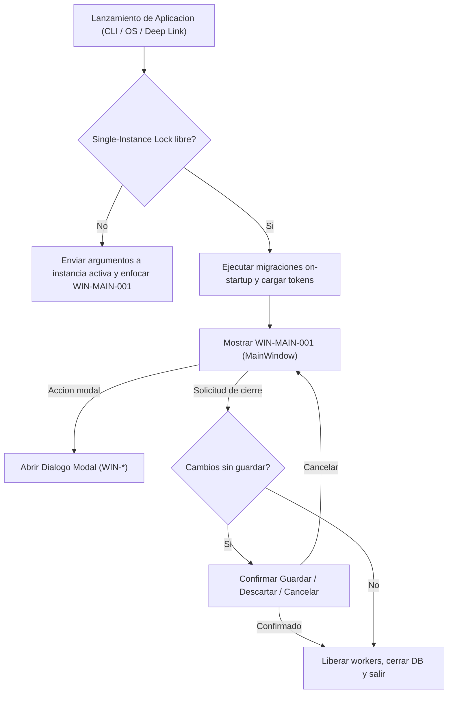

# Topologia de Ventanas y Contratos con el Sistema Operativo — {{PROJECT_NAME}}

## 1. Diagrama de Ciclo de Vida de Ventanas y Arranque (Mermaid)

---

## 2. Politica de Instancia Unica (`single_instance_policy`)

- **Habilitada (`enabled`):** `true` (ajustar a `false` si el producto permite múltiples procesos independientes).
- **Comportamiento en Segundo Lanzamiento:** Enfocar la ventana principal existente (`WIN-MAIN-001`) y reenviar argumentos CLI o ruta de archivo solicitada sin abrir una segunda instancia que bloquee `{{EMBEDDED_DB}}`.
- **Mecanismo IPC Local:** Named Pipes / Unix Domain Sockets / Mutex del SO según `{{ECOSYSTEM_FAMILY}}`.

---

## 3. Inventario de Ventanas y Dialogos (`WIN-*`)

| ID | Nombre | Flujo (`UF-*`) | Rol | Geometria Minima (px) | Guardia Cambios (`unsaved_changes_guard`) | Comportamiento al Cerrar |
| :--- | :--- | :--- | :--- | :--- | :--- | :--- |
| `WIN-MAIN-001` | `MainWindow` | `N/A` | `main` | `1024 x 680` | `true` | Solicita confirmación si hay estado `Dirty`; persiste geometría de ventana y cierra el proceso. |

---

## 4. Mapa de Comandos Globales y Atajos de Teclado

| Accion | Windows / Linux | macOS | Alcance (`scope`) |
| :--- | :--- | :--- | :--- |
| Guardar documento / estado activo | `Ctrl+S` | `Cmd+S` | `WIN-MAIN-001` |
| Abrir configuracion o preferencias | `Ctrl+,` | `Cmd+,` | Global |
| Cerrar dialogo o cancelar operacion | `Escape` | `Escape` | Modal / Operación activa |
| Salir de la aplicacion | `Alt+F4` / `Ctrl+Q` | `Cmd+Q` | Global (sujeto a `unsaved_changes_guard`) |

---

## 5. Contratos de Integracion con el Sistema Operativo (`os_integrations`)

- **Dialogos Nativos de Archivos (`file_dialogs`):** Usar los selectores nativos del SO provistos por `{{UI_TOOLKIT}}` filtrando extensiones explícitas y validando la ruta devuelta.
- **Drag and Drop (`drag_and_drop`):** Soportar apertura o importación controlada validando tipo MIME/extensión y canonizando rutas antes de delegar al módulo correspondiente.
- **Asociaciones de Extension (`file_associations`):** Sin extensiones registradas inicialmente (`none`); al registrar una extensión de proyecto, documentar el manifiesto OS (`.desktop`, `Info.plist`, registro MSIX/WiX).
- **Deep Links Locales (`deep_links`):** Deshabilitado por defecto (`none`). Si se habilita un esquema `app://`, validar parámetros estrictamente antes de despachar comandos.
- **Argumentos CLI (`cli_arguments`):** Soporte mínimo para `--version`, `--help` y apertura segura de ruta de archivo validada.
- **System Tray (`system_tray`):** Deshabilitado por defecto (`none`); documentar comportamiento de minimizar vs. cerrar si se adopta `tray-resident`.
- **Permisos del SO (`os_permissions`):** Operación estándar en espacio de usuario sin elevación de administrador ni privilegios root.

### Contratos IPC / FFI (Opcional para Shells Hibridos o Puentes Nativos)

> *Aplicable cuando el stack (`{{ECOSYSTEM_NAME}}`) utiliza un shell híbrido WebView o invocaciones nativas por FFI. Proyectos nativos puros v1.0.0 pueden omitir esta tabla o marcarla como `none`.*

| Canal / Simbolo | Direccion | Contrato de Payload | Validacion de Seguridad |
| :--- | :--- | :--- | :--- |
| `cmd:example_action` | `UI -> Core` | `{ input: string }` -> `{ ok: bool, data?: object }` | Validar esquema del payload en el core, restringir capacidades al `allowlist` declarado y canonizar cualquier ruta de archivo. |

---

## Historial de Revisiones (Últimos Cambios)

| Versión | Fecha | Requerimiento | Resumen del Cambio |
| :--- | :--- | :--- | :--- |
| `v{{CURRENT_VERSION}}` | {{TODAY}} | `INIT` | Definición inicial de ventana principal `WIN-MAIN-001`, instancia única y contratos del SO. |

> *Nota: Esta tabla mantiene una ventana deslizante de los últimos 3 cambios. Para el historial completo, consultar [`docs/backlog/changelog.md`](../backlog/changelog.md).*
