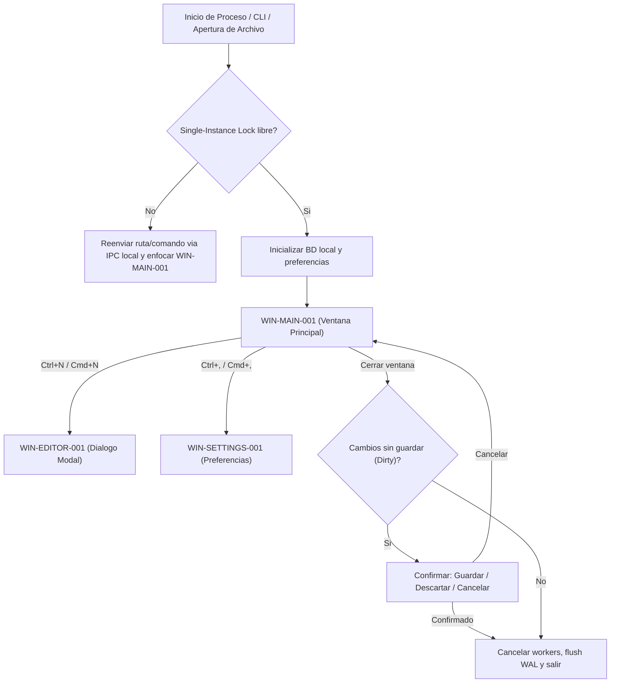

# Blueprint: Topologia de Ventanas y Contratos con el SO

## 1. Diagrama de Topologia y Ciclo de Vida (Mermaid)

---

## 2. Politica de Instancia Unica e Inventario de Ventanas (`WIN-*`)

- **Politica (`single_instance_policy`):** `enabled: true`, reenvío de argumentos mediante Named Pipes (Windows) / Unix Domain Socket (macOS/Linux) hacia la instancia activa y activación en primer plano de `WIN-MAIN-001`.

| ID | Nombre | Flujo (`UF-*`) | Rol | Geometria Minima (px) | Guardia Cambios | Comportamiento al Cerrar |
| :--- | :--- | :--- | :--- | :--- | :--- | :--- |
| `WIN-MAIN-001` | `MainWindow` | `UF-SHELL-001` | `main` | `1024 x 680` | `true` | Valida estado `Dirty` en documentos abiertos antes de terminar el proceso. |
| `WIN-EDITOR-001` | `ProductEditorDialog` | `UF-CATALOG-001` | `modal-dialog` | `520 x 420` | `true` | Solicita confirmación con `Escape`/`X` si hay borrador editado; restaura foco al disparador. |
| `WIN-SETTINGS-001` | `SettingsWindow` | `UF-SHELL-003` | `secondary` | `640 x 480` | `false` | Persiste preferencias de UI y cierra devolviendo foco a `WIN-MAIN-001`. |

---

## 3. Atajos Globales y Contratos con el SO

| Accion | Windows / Linux | macOS | Alcance |
| :--- | :--- | :--- | :--- |
| Nuevo registro / proyecto | `Ctrl+N` | `Cmd+N` | `WIN-MAIN-001` |
| Guardar cambios | `Ctrl+S` | `Cmd+S` | `WIN-MAIN-001` / `WIN-EDITOR-001` |
| Abrir preferencias | `Ctrl+,` | `Cmd+,` | Global |
| Cancelar / Cerrar modal | `Escape` | `Escape` | Diálogos modales |

### Integraciones Nativas Declaradas (`os_integrations`)
- **`file_dialogs`:** Selectores nativos del SO con filtros explícitos de extensión.
- **`drag_and_drop`:** Aceptar archivos válidos canonizando ruta y rechazando enlaces simbólicos no autorizados.
- **`file_associations`:** Declarar extensión propia (ej. `.dproj`) en manifiestos nativos de plataforma cuando aplique.
- **`deep_links`:** Esquema local validado o `none` si no aplica.
- **`cli_arguments`:** `--version`, `--help`, `--open <ruta-validada>`.
- **`system_tray`:** Icono de bandeja solo si `window_topology` es `tray-resident` (en caso contrario `none`).
- **`os_permissions`:** Ejecución sin privilegios elevados; permisos explícitos de lectura/escritura solo sobre rutas seleccionadas por el usuario o directorios estándar de la app.

### Contratos IPC / FFI (Opcional para Shells Hibridos o Puentes Nativos)

> *Aplicable cuando el proyecto utiliza un shell híbrido WebView o integraciones nativas por FFI. Proyectos nativos puros v1.0.0 pueden omitir o mantener esta subsección como `none`.*

| Canal / Simbolo | Direccion | Contrato de Payload | Validacion de Seguridad |
| :--- | :--- | :--- | :--- |
| `app:get_status` | `UI -> Core` | `{}` -> `{ ready: bool, version: string }` | Permitido solo desde origen local confiable (`allowlist`); sin acceso directo a shell/FS arbitrario. |

---

## Historial de Revisiones (Últimos Cambios)

| Versión | Fecha | Requerimiento | Resumen del Cambio |
| :--- | :--- | :--- | :--- |
| `v0.1.0` | YYYY-MM-DD | `REQ-DESK-SHELL-001` | Definición inicial de ventanas `WIN-*`, atajos multiplataforma y contratos del SO. |

> *Nota: Esta tabla mantiene una ventana deslizante de los últimos 3 cambios. Para el historial completo, consultar `docs/backlog/changelog.md`.*
